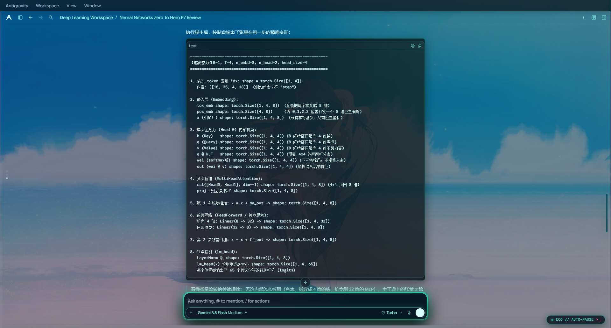

# 🎵 Antigravity 2.0 赛博终端亚克力美化主题 (Cyber Acrylic Theme)

> **设计理念**：深度融合赛博终端美学架构（Cyan 葱青 `#39E6C2` / Pink 荧粉 `#FF5C8A` / Blue 数码蓝 `#65B8FF` / Acrylic 亚克力磨砂毛玻璃 / 1080P 60FPS 流式视频背景 / Wallpaper Engine 级自动休眠节能引擎）。



---

## ✨ 核心特性

- 🌊 **1080P 60FPS 流畅视频背景**：内置轻量高清视频流（约 2.9MB），由本地微服务提供分段传输，GPU 占用率低于 2%，丝滑不卡顿。
- 🧊 **亚克力磨砂玻璃（Backdrop Glassmorphism）**：侧边栏 `blur(28px)`、输入框胶囊 `blur(32px)`，对话卡片半透明浮动，文字清晰可读。
- ⚡ **Wallpaper Engine 式自动休眠感知（Eco Mode）**：软件最小化、失去焦点或切入后台时，自动暂停（Pause）视频解码，前台秒级无感唤醒，真正 0 无效耗电。
- 🛡️ **主进程冷启动持久化机制**：解耦外部样式表，在 Electron 主进程中注入加载钩子，应用重启依然完美保持。
- 🎯 **设置弹窗防穿透实体化 & 左上角工具栏防漂移**：弹窗设定为实体底色与高层级，彻底消除毛玻璃重叠与排版推挤问题。

---

## 🚀 极速安装与使用指南

### 前置环境要求
- **Windows 10 / 11**
- **PowerShell 7 (`pwsh`)** 或系统自带 **Windows PowerShell**
- **Node.js** (v16+)

### 1. 初次安装 / 软件大版本更新后一键恢复
将本项目克隆或下载到本地任意目录，以管理员或普通用户身份在仓库根目录下打开 PowerShell 并执行：

```powershell
pwsh ./Install-MikuThemePatch.ps1
```

> **自动化执行流程**：
> 1. 自动检测并安全暂停正在运行的 Antigravity 客户端；
> 2. 自动备份官方出厂原始包 `app.asar.bak`；
> 3. 自动解包并在 `dist/utils.js` 窗口创建函数前注入动态样式与流媒体挂载钩子；
> 4. 重新打包为 `app.asar`；
> 5. 自动检查并后台拉起 1080P 本地视频流微服务（端口 `43939`）。  
> 整个过程仅需约 3 秒，启动 Antigravity 即可尽享极致美化！

---

### 2. 日常调节样式：一键热刷新（无需重启软件）
如果你在 `antigravity-miku-theme.css` 中微调了配色、毛玻璃模糊度或边框颜色，无需重启客户端，只需执行：

```powershell
pwsh ./Apply-MikuTheme.ps1
```
> 脚本将通过 Chrome DevTools 协议（CDP）在毫秒级将最新样式热同步到当前界面。

---

### 3. 一键还原官方出厂纯净默认状态
如果你需要排查官方 Bug 或临时换回官方出厂黑灰默认主题，只需执行：

```powershell
pwsh ./Restore-OriginalTheme.ps1
```
> 立即还原官方原版未修改的 `app.asar` 并禁用自定义样式表。

---

## 🎨 自定义壁纸与进阶配置

### 更换你自己的视频动态壁纸
1. 准备任意你喜欢的循环 MP4 视频（推荐分辨率 1080P，帧率 60fps，大小控制在 10MB 以内以获得最佳性能）；
2. 将其命名为 `miku_1080p_16s.mp4` 或 `background.mp4` 替换仓库根目录下的同名文件；
3. 运行 `pwsh ./Apply-MikuTheme.ps1` 即可即时看到新壁纸效果。

### 自定义流服务端口
默认流媒体服务运行在 `127.0.0.1:43939`。如需自定义端口，可在运行前指定环境变量：
```powershell
$env:PORT = "45000"
node ./stream_server.js
```

---

## 📂 项目结构

```text
├── antigravity-miku-theme.css  # 全局核心样式表（配色系统、亚克力毛玻璃、实体化防穿透规则）
├── miku_1080p_16s.mp4          # 1080P 60FPS 流式背景视频（轻量 2.9MB）
├── stream_server.js            # 本地轻量 HTTP 206 范围串流守护服务
├── Install-MikuThemePatch.ps1  # 【核心】一键修补并安装/还原美化的自动化脚本
├── Apply-MikuTheme.ps1         # 免重启样式热刷新执行脚本
├── apply-theme.js              # CDP 热重载注入脚本
├── Restore-OriginalTheme.ps1   # 官方出厂默认主题还原脚本
├── docs/
│   └── preview.png             # 效果展示截图
├── .gitignore                  # 隐私分离规则（严格过滤私有截图与临时日志）
└── README.md                   # 项目使用与架构说明
```

---

## 🔒 隐私与安全性保障 (Privacy & Security)

- **完全本地化**：所有视频串流与样式注入仅监听本地环回地址 (`127.0.0.1`)，不向任何外部网络发送或请求数据。
- **隐私隔离**：配置有严格的 `.gitignore` 规则，确保开发期间的会话截屏、聊天记录、调试脚本及私有资产永不进入 Git 追踪。
- **无破坏性修改**：安装脚本在初次运行时会自动对官方原始 `app.asar` 创建独立备份（`app.asar.bak`），随时支持无损一键还原。

---

## 📄 开源许可证

本项目基于 [MIT License](LICENSE) 开源。
